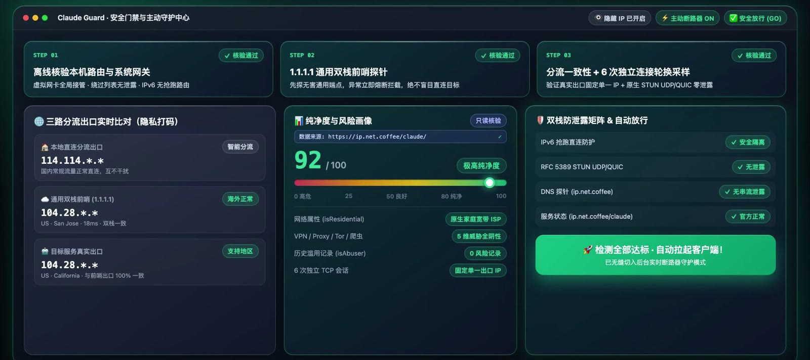
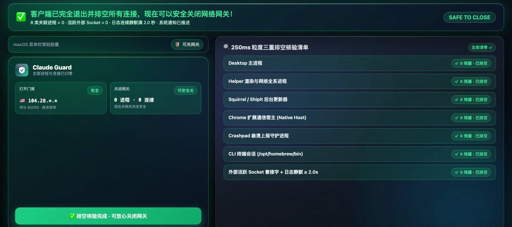
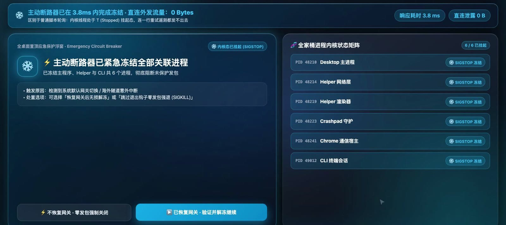
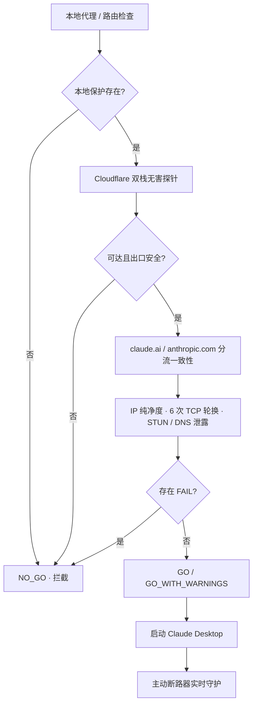

# Claude Guard

**macOS 原生 · Claude Desktop 安全门禁与主动断路器**

[](https://github.com/Wedian001/ClaudeGuard/actions/workflows/ci.yml)


> 先探路，再放行；掉线即冻结；排空确认后再关代理。

Claude Guard 是一个纯原生 **Swift 6 + SwiftUI** 的 macOS 菜单栏应用，附带同源命令行工具 `claude-guard`。它**不提供代理或 VPN**，而是在你已有代理 / TUN 的前提下，确保 Claude Desktop 的启动、运行和退出都不会意外绕过代理直连 Anthropic。



> 界面示意：截图来自项目宣传素材，实际界面与数据以当前版本为准。

---

## 为什么需要它

通过代理使用 Claude Desktop 时，真正危险的往往不是「打不开」，而是三种**裸连**：

| 时刻 | 可能发生什么 | Claude Guard 的处理 |
| --- | --- | --- |
| 没开代理 / 节点失效时启动 Claude | 登录、统计与遥测请求直接走本机网络 | 启动前完成本地 + 双栈 + 目标三层检测；任一失败即 `NO_GO`，不拉起 Claude |
| 使用中代理闪断、切节点、掉回受限地区 | Electron 自动重试，可能携带 Bearer Token | 监听系统代理 / 路由变化，百毫秒级 `SIGSTOP` 冻结全部 Claude 关联进程 |
| 关闭 Claude 后立刻关代理 | Helper、ShipIt、Crashpad、Claude Code CLI 仍可能后台发包 | 以 250ms 粒度核验 8 类进程、外部 Socket 与 `main.log` 静默 2 秒，全部归零才提示可关代理 |

---

## 核心能力

### 1. 安全打开 Claude：Fail-Closed 零泄露门禁

检测严格按顺序执行。只有前一步通过，才会访问下一步的目标；**在通用出口确认安全之前，不会向 `claude.ai` 发送任何请求**。

1. **本地环境**
   - 读取系统代理：HTTP / HTTPS / SOCKS5 / PAC，以及 `ExceptionsList` 是否绕过 Claude / Anthropic / 遥测域名。
   - 读取内核路由：Claude / Anthropic 的 IPv4 与 IPv6 是否进入 TUN 或代理；检测原生 IPv6 抢跑风险。
   - 识别 TUN、系统代理、PAC、仅 SOCKS5、直连等传输模式。
2. **无害双栈探针**
   - 同时访问 Cloudflare 的 IPv4 `1.1.1.1`、IPv6 `[2606:4700:4700::1111]` 与双栈域名 `one.one.one.one`。
   - 通用 IPv4 / 双栈探针均不可达、任一可用出口位于内置受限地区表，或 IPv6 走原生直连 → 立即熔断，报告 `NO_GO`。
3. **目标与纯净度**
   - 校验 `claude.ai`、`www.anthropic.com` 的真实出口是否落入受限地区、彼此国家是否一致，防止分流规则漏掉 Claude。
   - 查询第三方 IP 情报（`ip.net.coffee`）的 Trust Score、住宅 / 机房属性、VPN / Tor / 爬虫标记。
   - 6 次全新 TCP 连接采样出口 IP，检测机场侧负载均衡导致的 IP 轮换。
   - 原生 RFC 5389 STUN 检测 UDP 出口是否泄露；深度模式还会检测 DNS 泄露、中国大陆分流出口、服务状态。
   - 比对设备时区 / 语言与出口地区的一致性，并扫描 Claude 本地日志中的近期 `region_unavailable` / 403 记录。

判定结果：

| 结果 | CLI 退出码 | 行为 |
| --- | --- | --- |
| `GO` | `0` | 全部通过，可打开 Claude |
| `GO_WITH_WARNINGS` | `1` | 核心门禁通过，存在非阻断建议（机房 IP、IP 轮换、时区不一致等） |
| `NO_GO` | `2` | 存在直连 / 受限 / 分流风险，禁止打开 |

> GUI 默认允许在 `GO_WITH_WARNINGS` 时打开；如需严格模式，请以 CLI 退出码为准（`1` 也视为未完全通过）。

### 2. 安全退出：排空确认后再关代理

点击「安全关闭 Claude」后，Claude Guard 会：

1. 先评估当前代理状态。**如果代理 / TUN 已经断开**，不会执行 Electron 的优雅退出（避免 `beforeQuit` 在直连状态下上报），而是直接 `SIGKILL` 零发包清理。
2. 否则向 Claude Desktop 发送退出请求，并持续轮询 250ms 粒度的三重门禁：
   - **进程**：Desktop 主进程、全部 Helper、Squirrel / ShipIt、Chrome Native Host、Computer Use Helper、Crashpad、Claude Code CLI、SSH AskPass；
   - **网络**：Claude 关联的外部活动 Socket 是否归零；
   - **收尾**：`~/Library/Logs/Claude/main.log` 是否连续静默 ≥ 2 秒。
3. 全部通过后，界面 / 菜单栏亮起绿色确认横幅，播放提示音并推送系统通知：**「✅ Claude 已彻底关闭，现在可以安全关闭代理！」**
4. 若检测到浏览器仍连接 Anthropic 网段，会额外提醒关闭 `claude.ai` 网页标签。



### 3. 主动断路器：代理一断，立即冻结

运行期间持续监听：

- `SCDynamicStore`：系统代理、IPv4 / IPv6 状态变化；
- `NWPathMonitor`：网卡 / 路由拓扑变化；
- `NSWorkspace`：Claude 被 Dock / Spotlight 直接启动或退出；
- 15 秒一次的无害心跳：仅在 Claude 进程活跃时探测，捕捉「假 TUN / 节点已死但代理客户端仍显示连接」的情况。

代理配置变化会触发百毫秒级检查；如果只是节点出口变化而系统代理配置不变，则由 15 秒心跳兜底。

触发保护时：

- 对所有 Claude 关联进程发送 `SIGSTOP`，把线程挂起在内核态；进程不会继续执行，也就无法发出后续带凭据的请求。
- 弹出全桌面置顶应急浮窗，提供两个选择：
  - **已恢复代理 · 验证并解冻继续**：重新跑一次出口门禁，通过后 `SIGCONT` 无损恢复；
  - **不恢复代理 · 零发包强制关闭**：直接 `SIGKILL`，跳过 Electron 退出钩子。
- 如果 Claude 在没有代理 / TUN 的情况下被直接启动，启动瞬间就会被冻结并提示。



### 4. 诊断与 CLI

- 菜单栏常驻胶囊状态：安全 / 可开 / 禁开 / 冻结 / 可关代理。
- 本地 IP 历史：最多 20 条，保存在 `~/Library/Application Support/ClaudeGuard/ip_history.json`，可一键清除。
- IP 打码：界面和 CLI 均可隐藏 IP 后两段。
- JSON 输出：`--json` 便于快捷指令、Shell 脚本、监控系统集成。
- 深度体检：中国大陆分流出口对比、DNS 泄露、UDP STUN、Claude 服务状态、设备指纹一致性。
- 离线自检：`claude-guard selftest`，不联网即可验证关键解析与判定逻辑。
- 开机自启：可在主面板开启（通过 `SMAppService`，需在系统设置中确认）。

---

## 快速开始

### 方式 A：下载预编译版本

从 [Releases](https://github.com/Wedian001/ClaudeGuard/releases/latest) 下载最新 DMG，拖入「应用程序」后运行。

> 预编译 DMG 为 **Apple Silicon (arm64)** 构建；Intel Mac 请使用下方「从源码构建」。

> 本项目使用 **ad-hoc 本地签名**，没有 Apple Developer ID 公证。首次打开若提示「无法验证开发者 / 已损坏」，属于 Gatekeeper 对未公证应用的正常拦截，可运行 `scripts/一键解除macOS警告.command`（脚本只处理 ClaudeGuard.app），或手动执行：
>
> ```bash
> xattr -rd com.apple.quarantine /Applications/ClaudeGuard.app
> codesign --force --deep --sign - /Applications/ClaudeGuard.app
> ```

### 方式 B：从源码构建

环境要求：

- macOS **26.0+**（开发与测试环境为 macOS 27.0.1）
- Swift 6 工具链：`xcode-select --install` 安装 Command Line Tools 即可构建；若 `swift test` 报 Swift Testing 宏插件缺失，改用 `./scripts/test.sh`（会自动带上插件路径）。安装完整 Xcode 则无此问题。
- 已安装 Claude Desktop（路径固定为 `/Applications/Claude.app`）才能使用「打开 Claude」相关功能；仅做网络诊断不需要。

```bash
git clone https://github.com/Wedian001/ClaudeGuard.git
cd ClaudeGuard

# 1. 运行离线测试（自动适配 CLT-only 工具链）
./scripts/test.sh

# 2. 构建 .app（自动生成图标、ad-hoc 签名）
./scripts/bundle_app.sh

# 3. 启动
open dist/ClaudeGuard.app
```

制作 DMG：

```bash
./scripts/build_dmg.sh
# 输出：dist/ClaudeGuard-<version>-macOS.dmg
```

---

## 命令行 `claude-guard`

打包后的 CLI 位于 `.app` 内部：

```bash
BIN="dist/ClaudeGuard.app/Contents/MacOS/claude-guard"
```

| 命令 | 说明 |
| --- | --- |
| `status` | 同时查看「能否开 Claude」与「能否关代理」；默认仅本地，`--net` 开启出口探测 |
| `open-check` | 完整打开前检测（双栈、分流、IP 纯净度、轮换采样） |
| `close-check` | 关代理前检查（进程、Socket、日志静默） |
| `open` | 执行 `open-check`，通过后启动 `/Applications/Claude.app` |
| `quit` | 安全退出 Claude，等待排空，报告是否可关代理（最长 30 秒） |
| `deep` | 全量深度检测（额外包含 DNS 泄露、UDP STUN、中国出口对比、服务状态） |
| `watch` | 持续监控状态变化，默认每 3 秒刷新 |
| `selftest` | 离线自检，不联网 |
| `help` | 显示帮助 |

通用参数：`--json`、`--net`、`--deep`、`--samples N`、`--timeout N`、`--mask-ip`。

示例：

```bash
# 本地快速状态
$BIN status

# 完整打开前检测，输出 JSON 并只看 verdict
$BIN open-check --json | jq -r '.verdict'

# 深度体检（IP 打码）
$BIN deep --mask-ip

# 退出 Claude 并确认是否可以关代理
$BIN quit
```

退出码：`0` = GO / 安全；`1` = GO_WITH_WARNINGS；`2` = NO_GO / 不可关闭代理。

---

## 工作原理



核心设计：

- **Fail-Closed（阻断项）**：本地代理 / 路由、双栈 canary、`claude.ai` 目标探测等决定能否启动的检查，失败、超时或数据缺失一律拒绝。
- **深度诊断项**：IP 情报、DNS、STUN、国内出口等属于 best-effort；数据源不可用时会显示为 INFO / 未知，而不是伪造 PASS。其中 STUN 若测得受限地区 UDP 出口，仍会直接判 `NO_GO`。
- **无凭据探测**：探针只访问 `/cdn-cgi/trace`、IP 情报和 STUN 端点，不登录、不带 Cookie、不复用连接。
- **零第三方依赖**：只使用 Swift 标准库、SwiftUI、AppKit、Network、SystemConfiguration、CFNetwork 等系统框架。
- **可测试**：`GateEvaluator` 通过协议注入网络、进程与信号实现，测试用固定样本离线运行。

---

## 隐私与网络请求

Claude Guard **没有账号系统、没有遥测、不会上传会话内容**。所有判断都在本机完成；只有以下探测会访问网络：

| 目标 | 用途 | 发送内容 |
| --- | --- | --- |
| `1.1.1.1` / `one.one.one.one` / `[2606:4700:4700::1111]` 的 `/cdn-cgi/trace` | 无害双栈出口探针 | 出口 IP、地区、延迟（由 Cloudflare 返回） |
| `ip.net.coffee` 的 `/api/iprisk`、`/api/geoip`、`/claude/status.json`、`*.d.ip.net.coffee` | IP 纯净度、DNS 泄露、服务状态 | 待查询的出口 IP、随机 DNS token |
| `2026.ip138.com` / `my.ip.cn` | 深度模式下对比中国大陆分流出口 | 常规 HTTPS 请求 |
| `stun.cloudflare.com:3478` / `stun.l.google.com:19302` | UDP 出口泄露检测 | RFC 5389 STUN Binding 请求 |
| `claude.ai`、`www.anthropic.com` 的 `/cdn-cgi/trace` | 目标域名分流一致性 | 无 Cookie、无凭据的 trace 请求 |

- 探针使用 ephemeral `URLSession`：无 Cookie、无缓存、`Connection: close`、每个 host 单连接，模拟 Electron / Chromium 的代理行为。
- `ip.net.coffee` 是第三方 IP 情报服务，其可用性、隐私政策与服务条款由运营方决定；本项目不控制该服务。
- 本地数据仅包括：`ip_history.json`（最近 20 次出口信息，可清除）、Claude 日志尾部（只读）、`ps` / `lsof` 的本机进程与连接信息。
- 应用以菜单栏常驻方式运行：关闭主窗口不会退出，选择菜单中的「退出」才会结束进程。

---

## 系统要求与权限

- **系统**：macOS 26.0+；在 macOS 27.0.1 / Apple Silicon 上开发与测试。
- **工具链**：Swift 6（测试使用 Swift 6.4）；无第三方依赖。
- **权限**：
  - 不需要 root / 管理员权限；
  - 不需要「辅助功能 / 屏幕录制」权限；
  - 系统通知为可选项；
  - 开机自启通过 `SMAppService` 注册，需在系统设置中确认。
- **作用范围**：只对当前用户、路径为 `/Applications/Claude.app` 的 Claude Desktop 及其关联进程生效；不会主动操作浏览器、代理客户端或其他常规应用。如果某个自定义脚本的命令行恰好包含 `claude`，也可能被识别为 Claude Code CLI，请先查看进程列表再执行冻结 / 强退。
- **签名**：ad-hoc 签名，未公证；首次启动需处理 Gatekeeper 提示。

---

## 项目结构

```text
ClaudeGuard/
├── Package.swift                     # SwiftPM 清单：Core 库 + App + CLI + 测试
├── Sources/
│   ├── ClaudeGuardCore/              # 无 UI 的核心逻辑，可被 App / CLI 复用
│   │   ├── Engine/                   # 门禁判定、报告格式化、离线自检
│   │   ├── Controller/               # 生命周期控制、主动断路器
│   │   ├── Local/                    # 代理/路由、进程/Socket、日志、Shell
│   │   ├── Net/                      # 双栈探测、IP 风险、STUN、DNS 泄露
│   │   └── Models/                   # 数据模型、受限地区表、IP 打码
│   ├── ClaudeGuardApp/               # SwiftUI 菜单栏 + 主面板 + 应急浮窗
│   └── ClaudeGuardCLI/               # claude-guard 命令行
├── Tests/ClaudeGuardTests/           # 离线单元测试
├── scripts/
│   ├── test.sh                       # 离线测试（适配 CLT-only Testing 插件）
│   ├── bundle_app.sh                 # 生成 .app（图标 + ad-hoc 签名）
│   ├── build_dmg.sh                  # 生成 DMG
│   └── 一键解除macOS警告.command      # Gatekeeper 隔离属性修复
└── docs/screenshots/                 # README 截图
```

---

## 开发与测试

```bash
./scripts/test.sh           # 离线单元测试（自动适配 CLT-only 工具链）
swift build                 # Debug 构建
swift build -c release      # Release 构建
swift run claude-guard selftest
```

CI 会在 `macos-26`（arm64）与 `macos-26-intel`（x64）两个 GitHub Actions runner 上执行 `swift test`。

提交 PR 前请确保：

1. `./scripts/test.sh` 全部通过；
2. 不引入第三方运行时依赖；
3. 不削弱阻断性检查的 Fail-Closed 行为（新增阻断检查应默认拒绝）；
4. 不在日志、测试或注释中写入真实 IP、Token、Cookie、个人路径。

---

## 已知限制

- **不是代理工具**：不提供节点，也不能绕过地区限制；它只验证你现有的网络路径并阻止泄露。
- 受限地区表与 IP 风险评分是启发式判断，**不代表 Anthropic 的官方政策**；服务条款与可用地区可能变化。
- 部分能力依赖第三方服务（`ip.net.coffee`、Cloudflare、Google STUN、ip138 / my.ip.cn）。服务不可用时，相关检查会降级或按 Fail-Closed 拦截。
- 进程冻结 / 强退依赖向同一用户的进程发送 `SIGSTOP` / `SIGCONT` / `SIGKILL`；若 Claude 以其他用户身份运行，或进程受系统完整性保护，可能无法冻结。
- 强退会丢失 Claude 中未保存的编辑内容；请优先使用「恢复代理后解冻」或正常退出。
- 目前只支持 macOS，且默认 Claude Desktop 安装在 `/Applications/Claude.app`。
- ad-hoc 签名、未公证；不提供自动更新。

---

## 使用须知与免责声明

- 本项目是独立开源项目，**与 Anthropic 没有任何关联、赞助或背书**。Claude、Anthropic 及相关名称为其各自权利人的商标。
- 本项目不提供、不推荐任何代理服务，也不鼓励规避服务条款或当地法律。请自行确保你的使用方式符合 Anthropic 服务条款、你所在地区的法律法规以及你的网络服务提供商政策。
- 冻结 / 强退进程可能造成未保存数据丢失。请在使用前阅读代码并自行评估风险。
- 软件按 MIT 许可证「按原样」提供，不附带任何明示或暗示担保。

---

## 贡献

欢迎 Issue 与 Pull Request。请先搜索已有 Issue；提交代码时附上复现步骤、macOS / Swift 版本和相关日志（注意打码 IP 与个人信息）。

安全漏洞请不要公开 Issue，使用 GitHub 的 [Security Advisories](https://github.com/Wedian001/ClaudeGuard/security/advisories) 私下报告。

---

## License

[MIT](LICENSE) © 2026 Dylan Wei

---

## English Summary

Claude Guard is a native macOS menu-bar safety gate for Claude Desktop. It does **not** provide a proxy or VPN. Given an existing proxy/TUN, it verifies that Claude's traffic will not leak directly to Anthropic: a fail-closed pre-flight check (local proxy/routes → harmless dual-stack canary → Claude/Anthropic split consistency, IP reputation, TCP rotation, STUN/DNS leak), a drain-verified safe-quit flow (8 process families, sockets, log silence), and an active circuit breaker that `SIGSTOP`s Claude processes the moment the proxy drops. Built with Swift 6 + SwiftUI, zero third-party dependencies, MIT licensed.
